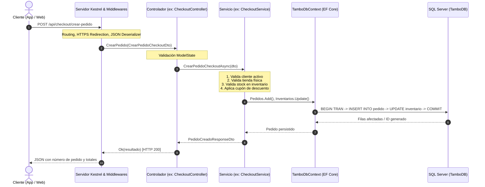
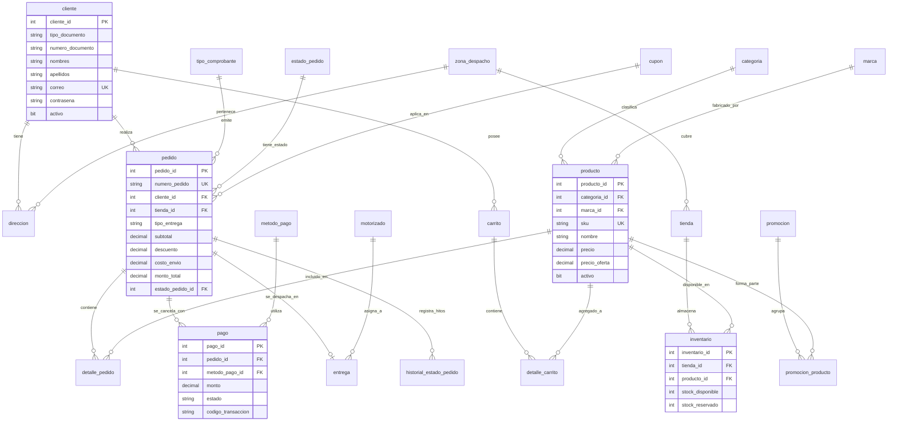

# Documentación Técnica del Backend: E-commerce Tambo+
**Proyecto:** Arquitectura Orientada a Servicios (SOA) - Backend API  
**Tecnología:** .NET 10.0 (C#) | ASP.NET Core Web API | Entity Framework Core 10 | SQL Server (TamboDB)  
**Fecha:** Noviembre 2026  

---

## 1. Arquitectura General

El backend está diseñado bajo una **Arquitectura en N-Capas Orientada a Servicios (SOA)**, aplicando principios de alta cohesión, bajo acoplamiento y separación de responsabilidades (*Separation of Concerns*).

```
                      ┌────────────────────────────────────────┐
                      │            Cliente Web / App           │
                      └───────────────────┬────────────────────┘
                                          │ HTTP / JSON
                                          ▼
                      ┌────────────────────────────────────────┐
                      │          1. CAPA DE PRESENTACIÓN       │
                      │         (Controllers & Middleware)     │
                      └───────────────────┬────────────────────┘
                                          │ Inyección de Dependencias
                                          ▼
                      ┌────────────────────────────────────────┐
                      │           2. CAPA DE SERVICIO          │
                      │       (Reglas y Lógica de Negocio)     │
                      └───────────────────┬────────────────────┘
                                          │ DTOs / Entities
                                          ▼
                      ┌────────────────────────────────────────┐
                      │           3. CAPA DE DATOS             │
                      │        (TamboDbContext / EF Core)      │
                      └───────────────────┬────────────────────┘
                                          │ T-SQL / ADO.NET
                                          ▼
                      ┌────────────────────────────────────────┐
                      │          4. BASE DE DATOS              │
                      │          (SQL Server: TamboDB)         │
                      └────────────────────────────────────────┘
```

### 1.1 Estructura del Proyecto (`WebApi`)

```
WebApi/
├── Common/
│   └── PasswordHasher.cs        # Utilidad transversal de seguridad criptográfica (PBKDF2 con SHA-256)
├── Controllers/
│   ├── AuthController.cs        # Endpoints para Autenticación, Registro y Direcciones
│   ├── CarritoController.cs     # Endpoints para Gestión de Carrito de Compras
│   ├── CatalogoController.cs    # Endpoints para Menú de Categorías, Productos y Búsqueda Predictiva
│   ├── CheckoutController.cs    # Endpoints para Cobertura, Tiendas, Stock, Pedidos y Pagos
│   └── PromocionesController.cs # Endpoints para Tambo Packs y Cupones de Descuento
├── Data/
│   └── TamboDbContext.cs        # Contexto relacional de EF Core y configuración Fluent API
├── DTOs/
│   ├── AuthDtos.cs              # Objetos de transferencia de datos de sesión y registro
│   ├── CarritoDtos.cs           # DTOs de items del carrito y acciones de modificación
│   ├── CatalogoDtos.cs          # DTOs de navegación, búsqueda y fichas de producto
│   ├── CheckoutDtos.cs          # DTOs de logística, comprobantes, pasarela y tracking
│   └── PromocionDtos.cs         # DTOs de packs promocionales y cupones de descuento
├── Models/
│   └── Entities.cs              # Entidades del dominio relacional (23 modelos de tablas)
├── Properties/
│   └── launchSettings.json      # Perfiles de inicio de depuración (Kestrel y puertos)
├── Services/
│   ├── AuthService.cs           # Lógica de login, hash y libreta de direcciones
│   ├── CarritoService.cs        # Lógica de persistencia de carrito y validación de compras
│   ├── CatalogoService.cs       # Lógica de catálogo, inventario y buscador
│   ├── CheckoutService.cs       # Lógica de checkout, control de stock por tienda y pasarela
│   ├── PromocionService.cs      # Lógica de validación de cupones y packs
│   ├── IAuthService.cs          # Contrato de servicio de autenticación
│   ├── ICarritoService.cs       # Contrato de servicio de carrito
│   ├── ICatalogoService.cs      # Contrato de servicio de catálogo
│   ├── ICheckoutService.cs      # Contrato de servicio de checkout
│   └── IPromocionService.cs     # Contrato de servicio de promociones
├── appsettings.json             # Cadenas de conexión y configuración global
├── Program.cs                   # Configuración del servidor, Inyección de Dependencias y Middlewares
├── WebApi.csproj                # Definición de dependencias NuGet y compilación XML
└── WebApi.http                  # Pruebas HTTP interactivas listas para ejecución
```

### 1.2 Responsabilidades por Capa

1. **Capa de Controladores (`Controllers`):**
   * Exponen los endpoints HTTP bajo estándares REST.
   * Manejan la deserialización de datos, validación sintáctica (`ModelState.IsValid`) y devuelven códigos de estado HTTP apropiados (`200 OK`, `201 Created`, `400 BadRequest`, `401 Unauthorized`, `404 NotFound`).
   * No contienen lógica de negocio ni acceden directamente a la base de datos; delegan 100% en los servicios.

2. **Capa de Lógica de Negocio (`Services`):**
   * Orquestan y ejecutan las reglas de negocio de Tambo+ (ej. verificar que un cliente esté activo, validar que el stock de una tienda física cubra el pedido, aplicar límites de promociones por cliente, calcular descuentos por cupón).
   * Se comunican con la capa de datos (`TamboDbContext`) y transforman las entidades internas en DTOs seguros.

3. **Capa de Objetos de Transferencia (`DTOs`):**
   * Desacoplan el modelo de persistencia física de la API externa.
   * Evitan sobreexposición de campos sensibles (como contraseñas o datos bancarios completos).

4. **Capa de Dominio y Datos (`Models` y `Data`):**
   * `Entities.cs` representa las tablas de SQL Server mediante atributos de Entity Framework Core (`[Table]`, `[Key]`, `[Column]`, `[ForeignKey]`).
   * `TamboDbContext` gestiona las sesiones de conexión, el seguimiento de cambios (*Change Tracker*), índices y restricciones únicas.

---

## 2. Flujo de una Petición (Request Lifecycle)

Cuando un cliente (Frontend web, app móvil o llamada HTTP) realiza una petición al backend, la solicitud recorre el pipeline de ASP.NET Core de la siguiente manera:



### 2.1 Inyección de Dependencias (IoC Container)
ASP.NET Core utiliza un contenedor de inversión de control (*Dependency Injection Container*) configurado en `Program.cs`. Todos los servicios se registran con ciclo de vida **Scoped** (una instancia por cada solicitud HTTP):
```csharp
builder.Services.AddDbContext<TamboDbContext>(options => options.UseSqlServer(connectionString));
builder.Services.AddScoped<IAuthService, AuthService>();
builder.Services.AddScoped<ICheckoutService, CheckoutService>();
builder.Services.AddScoped<ICatalogoService, CatalogoService>();
builder.Services.AddScoped<IPromocionService, PromocionService>();
builder.Services.AddScoped<ICarritoService, CarritoService>();
```

### 2.2 Pipeline de Middlewares
1. **`UseSwagger` y `UseSwaggerUI`:** Publica la especificación OpenAPI en `/swagger/v1/swagger.json` y la interfaz interactiva en `https://localhost:7180/swagger/index.html`.
2. **Redirección Raíz:** `app.MapGet("/", () => Results.Redirect("/swagger"))` redirige accesos raíz directamente al panel interactivo.
3. **`UseHttpsRedirection`:** Fuerza el uso de protocolo seguro TLS/HTTPS.
4. **`UseAuthorization`:** Middleware de seguridad para validar permisos de acceso.
5. **`MapControllers`:** Enruta las solicitudes entrantes al controlador y acción correspondiente.

---

## 3. Catálogo de Endpoints de la API

La API cuenta con 19 servicios SOA distribuidos en 5 controladores:

| N.° | Controlador | Método | Ruta del Endpoint | Parámetros de Entrada | Respuesta Exitosa | Códigos HTTP |
|:---:|:---|:---:|:---|:---|:---|:---:|
| **1** | `Catalogo` | `GET` | `/api/catalogo/categorias` | Ninguno | `IEnumerable<CategoriaDto>` | 200 |
| **2** | `Catalogo` | `GET` | `/api/catalogo/categorias/{categoriaId}/subcategorias` | `categoriaId` (Ruta) | `IEnumerable<SubcategoriaDto>` | 200 |
| **6** | `Catalogo` | `GET` | `/api/catalogo/productos/buscar` | `termino` (Query, ej: "cerveza") | `IEnumerable<ProductoBuscadorDto>` | 200 |
| **7** | `Catalogo` | `GET` | `/api/catalogo/productos/categoria/{categoriaId}` | `categoriaId` (Ruta) | `IEnumerable<ProductoCatalogoDto>` | 200 |
| **9** | `Catalogo` | `GET` | `/api/catalogo/productos/{productoId}/detalle` | `productoId` (Ruta), `cantidad` (Query), `tiendaId` (Query) | `DetalleProductoResponseDto` | 200, 404 |
| **8** | `Promociones` | `GET` | `/api/promociones/packs` | Ninguno | `IEnumerable<PromocionPackDto>` | 200 |
| **11** | `Promociones` | `POST` | `/api/promociones/cupones/validar` | `ValidarCuponRequestDto` (Body) | `ValidarCuponResponseDto` | 200, 400 |
| **10a**| `Carrito` | `GET` | `/api/carrito/{clienteId}` | `clienteId` (Ruta), `tiendaId`, `direccionId`, `tiendaRetiroId` (Query) | `CarritoResponseDto` | 200 |
| **10b**| `Carrito` | `POST` | `/api/carrito/gestionar` | `GestionarCarritoRequestDto` (Body: AGREGAR, EDITAR, ELIMINAR) | `CarritoResponseDto` | 200, 400 |
| **12** | `Auth` | `POST` | `/api/auth/login` | `LoginRequestDto` (Body: Correo, Contraseña) | `LoginResponseDto` | 200, 400, 401 |
| **13** | `Auth` | `POST` | `/api/auth/registro` | `RegistroClienteDto` (Body: Doc, Nombres, Correo, Clave) | `LoginResponseDto` | 200, 400 |
| **14a**| `Auth` | `GET` | `/api/auth/clientes/{clienteId}/direcciones` | `clienteId` (Ruta) | `IEnumerable<DireccionDto>` | 200 |
| **14b**| `Auth` | `POST` | `/api/auth/clientes/{clienteId}/direcciones` | `clienteId` (Ruta), `CrearDireccionDto` (Body) | `DireccionDto` | 201, 400, 404 |
| **4** | `Checkout` | `POST` | `/api/checkout/cobertura` | `ValidarCoberturaRequestDto` (Body: Distrito, Dirección) | `CoberturaResponseDto` | 200, 400 |
| **5** | `Checkout` | `GET` | `/api/checkout/tiendas-retiro` | `busqueda` (Query opcional) | `IEnumerable<TiendaRetiroDto>` | 200 |
| **15** | `Checkout` | `GET` | `/api/checkout/tipos-comprobante` | Ninguno | `IEnumerable<TipoComprobanteDto>` | 200 |
| **16** | `Checkout` | `POST` | `/api/checkout/metodos-pago` | `ConsultarMetodosPagoRequestDto` (Body: TiendaId, Items) | `ConsultarMetodosPagoResponseDto` | 200, 400 |
| **3** | `Checkout` | `POST` | `/api/checkout/crear-pedido` | `CrearPedidoCheckoutDto` (Body: Modalidad, Items, etc.) | `PedidoCreadoResponseDto` | 200, 400 |
| **17** | `Checkout` | `POST` | `/api/checkout/pagar-tarjeta` | `ProcesarPagoTarjetaDto` (Body: Tarjeta, CVV, Titular) | `PagoResponseDto` | 200, 400 |
| **18** | `Checkout` | `GET` | `/api/checkout/orden/{pedidoId}` | `pedidoId` (Ruta) | `ResumenOrdenPasarelaDto` | 200, 404 |
| **19** | `Checkout` | `GET` | `/api/checkout/seguimiento/{numeroPedido}` | `numeroPedido` (Ruta: ej. 'TMB-202611-0001') | `SeguimientoPedidoDto` | 200, 404 |

---

## 4. Lógica de Negocio y Reglas Críticas (Capa de Servicios)

### 4.1 `AuthService`
* **Inicio de Sesión (Servicio 12):**
  * Validación obligatoria de correo y contraseña.
  * Verificación del estado activo: Si `cliente.activo = 0`, bloquea el login con mensaje explícito.
  * Comprobación de contraseña hasheada mediante algoritmo seguro de tiempo constante.
  * Actualización de marca temporal en `ultimo_acceso`.
* **Registro de Cliente (Servicio 13):**
  * Verificación previa de unicidad en dos frentes: el correo electrónico y la tupla `(tipo_documento, numero_documento)` no pueden existir previamente.
  * Hashing automático de la contraseña mediante PBKDF2 (100,000 iteraciones SHA-256 y salt de 128 bits aleatorio).
  * Creación del usuario con estado activo por defecto (`activo = 1`).
* **Libreta de Direcciones (Servicio 14):**
  * Asignación automática de `zona_id` buscando la zona de despacho activa que coincida con el distrito.
  * Si una dirección se marca como `principal = true`, las demás direcciones del cliente se actualizan a `principal = false`.

### 4.2 `CatalogoService`
* **Menú Jerárquico (Servicios 1 y 2):**
  * Las categorías principales filtran estrictamente por `categoria_padre_id IS NULL` y `borrado = 0`.
  * Las subcategorías filtran por el identificador del padre seleccionado.
* **Buscador Predictivo (Servicio 6):**
  * Búsqueda no sensible a mayúsculas sobre nombre de producto, marca o SKU, omitiendo productos borrados o inactivos.
* **Listado por Sección (Servicio 7):**
  * Resuelve recursividad: si se solicita una categoría padre, incluye automáticamente los productos de sus subcategorías.
  * Vincula promociones activas en tiempo real calculando el porcentaje de descuento comercial.
* **Ficha Técnica y Control de Stock (Servicio 9):**
  * Valida que la cantidad solicitada no sobrepase el stock disponible en la tienda física elegida (`inventario.stock_disponible`).
  * Si el producto pertenece a una promoción activa, valida la regla `cantidad <= promocion.max_por_cliente`.

### 4.3 `PromocionService`
* **Tambo Packs (Servicio 8):**
  * Solo se muestran combos cuya vigencia cumpla `fecha_inicio <= UTC_NOW <= fecha_fin` y se encuentren activos.
  * Incluye la composición detallada de productos dentro del pack.
* **Validación de Cupones (Servicio 11):**
  * Valida código existente y activo.
  * Control de vigencia por fechas.
  * Control de tope de usos máximos (`usos_actuales < usos_maximos`).
  * Valida el umbral de compra (`subtotal >= monto_minimo_compra`).
  * Soporta tipos de descuento porcentuales (`PORCENTAJE`) y de monto fijo en soles (`MONTO_FIJO`).

### 4.4 `CarritoService`
* **Gestión de Carrito (Servicio 10):**
  * Acciones soportadas: `AGREGAR` (crea o acumula cantidad), `EDITAR` (modifica cantidad exacta o elimina si es <= 0) y `ELIMINAR`.
  * Precios sincronizados con el valor vigente (`precio_oferta ?? precio`).
  * **Regla de Negocio Crítica:** La propiedad `PuedeContinuarCompra` solo es `true` si el cliente ha ingresado una dirección de entrega válida o ha seleccionado una tienda de retiro.

### 4.5 `CheckoutService`
* **Validación de Cobertura (Servicio 4):**
  * Verifica si el distrito ingresado pertenece a una `zona_despacho` habilitada.
  * Comprueba que exista al menos una tienda Tambo+ asociada a dicha zona con `delivery_activo = 1`.
* **Disponibilidad de Métodos de Pago con Filtro de Stock (Servicio 16):**
  * **Regla crítica de negocio:** Antes de permitir el pago, valida el stock de todos los productos en la tienda asignada. Si un solo producto no cuenta con existencias suficientes, bloquea la visualización de métodos de pago y devuelve un detalle con el producto faltante, la cantidad solicitada y el stock real disponible.
* **Generación de Pedido (Servicio 3):**
  * Descuenta el inventario disponible y lo traslada a `stock_reservado`.
  * Genera el correlativo único con formato `TMB-YYYYMMDD-XXXX`.
  * Asigna el estado inicial `CONFIRMADO` y crea el primer hito en `historial_estado_pedido`.
* **Procesamiento de Pago con Tarjeta (Servicio 17):**
  * Valida que el pedido no cuente previamente con un pago aprobado.
  * Cobra exactamente el `monto_total` del pedido.
  * Simula la autorización bancaria con pasarela (Niubiz/Visa): genera código de transacción único (`TXN-NIUBIZ-...`).
  * Al autorizarse, cambia el estado del pedido a `PREPARANDO` y crea la orden en la tabla `entrega` con asignación de motorizado.
* **Seguimiento del Pedido (Servicio 19):**
  * Respeta la secuencia del ciclo de vida: `Confirmado ➔ Preparando ➔ En camino ➔ Entregado`.
  * Muestra datos de contacto del repartidor (nombre, celular, placa y modelo de moto) únicamente cuando la orden tiene un motorizado asignado.

---

## 5. Capa de Datos y SQL Server (`script.sql`)

### 5.1 Proveedor de Acceso a Datos
* **ORM:** Entity Framework Core 10 con proveedor `Microsoft.EntityFrameworkCore.SqlServer`.
* **Consultas:** Implementadas con **LINQ to Entities** parametrizado, lo cual previene vulnerabilidades de Inyección SQL (SQL Injection).
* **Carga de Datos:** Uso de `.Include()` y `.ThenInclude()` para relaciones complejas y `.Select()` para proyecciones óptimas.

### 5.2 Diagrama Entidad-Relación (ER)



### 5.3 Estructura del Script de Base de Datos (`script.sql`)
El archivo [script.sql](file:///c:/Users/juanr/source/repos/SOA_tarea/script.sql) en la raíz del proyecto contiene:
1. **Base de Datos:** Creación de `TamboDB` con intercalación moderna en español (`Modern_Spanish_CI_AS`).
2. **23 Tablas Relacionales:**
   * **Clientes:** `cliente`, `direccion`.
   * **Catálogo:** `categoria`, `marca`, `producto`, `inventario`.
   * **Promociones:** `banner`, `promocion`, `promocion_producto`, `cupon`, `cupon_uso`.
   * **Logística:** `zona_despacho`, `tienda`, `motorizado`.
   * **Ventas:** `carrito`, `detalle_carrito`, `tipo_comprobante`, `estado_pedido`, `pedido`, `detalle_pedido`.
   * **Pagos y Tracking:** `metodo_pago`, `pago`, `entrega`, `historial_estado_pedido`.
3. **Índices de Alto Rendimiento:**
   * `IX_producto_nombre_marca`: Optimiza el buscador predictivo.
   * `IX_producto_categoria`: Acelera la navegación por catálogo.
   * `IX_inventario_tienda_producto`: Clave para las validaciones instantáneas de stock por tienda.
   * `IX_cliente_correo_activo`: Autenticación rápida por correo electrónico.
4. **Datos Semilla (Seed Data):**
   * Tiendas Tambo+ en Lima (Schell, Benavides, Dos de Mayo, Chacarilla).
   * Zonas de despacho con tiempos y tarifas de envío.
   * Catálogo de cervezas, empanadas, hamburguesas, gaseosas y energizantes.
   * Promociones tipo "Tambo Packs" (Pack Chelero, Combo Bajón).
   * Cupones de descuento (`TAMBO10`, `ENVIOFREE`).
   * Métodos de pago (Tarjeta, PagoEfectivo, Niubiz con Yape).

---

## 6. Configuración y Ejecución Local

### 6.1 Requisitos Previos
* **.NET SDK 10.0** (o posterior).
* **Microsoft SQL Server** (2019, 2022 o SQL Server Express / LocalDB).
* **Visual Studio 2022/2026** o **Visual Studio Code** con la extensión C# Dev Kit.

### 6.2 Paso a Paso para Desplegar

#### 1. Crear la Base de Datos
Abre SQL Server Management Studio (SSMS), Azure Data Studio o la terminal sqlcmd y ejecuta el script [script.sql](file:///c:/Users/juanr/source/repos/SOA_tarea/script.sql):
```sql
-- Ejecutar en SQL Server
:r c:\Users\juanr\source\repos\SOA_tarea\script.sql
```

#### 2. Configurar la Cadena de Conexión
Verifica que la clave `ConnectionStrings:TamboDbConnection` en [appsettings.json](file:///c:/Users/juanr/source/repos/SOA_tarea/WebApi/appsettings.json) coincida con tu instancia local:
```json
{
  "ConnectionStrings": {
    "TamboDbConnection": "Server=.;Database=TamboDB;Trusted_Connection=True;TrustServerCertificate=True;MultipleActiveResultSets=true"
  }
}
```
*(Si usas SQL Server Express, cambia `Server=.` por `Server=.\\SQLEXPRESS`).*

#### 3. Compilar el Proyecto
Desde la terminal en el directorio raíz o en la carpeta `WebApi`:
```bash
dotnet build WebApi/WebApi.csproj
```

#### 4. Ejecutar la Aplicación
* **Desde Visual Studio:** Presiona **F5** o el botón "Iniciar depuración".
* **Desde la línea de comandos:**
  ```bash
  dotnet run --project WebApi/WebApi.csproj
  ```

#### 5. Probar los Servicios
* **Swagger UI:** El navegador se abrirá automáticamente en:
  👉 **`https://localhost:7180/swagger/index.html`**
* **Archivo de Pruebas HTTP:** Puedes abrir [WebApi.http](file:///c:/Users/juanr/source/repos/SOA_tarea/WebApi/WebApi.http) en Visual Studio o VS Code y hacer clic en **"Send Request"** sobre cualquiera de los 19 servicios preconfigurados.
